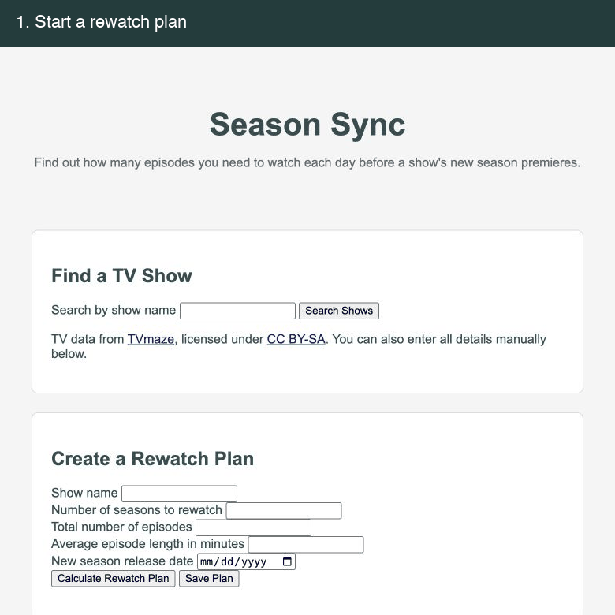

# Season Sync

Season Sync is a web application that helps users calculate
how much of a television series they need to watch each day before
a new season is released.

## See It in Action

Search for a show, select seasons, enter a premiere date, and generate a daily
episode target with a dated viewing schedule.

The premiere date in this demo is an example, not an announced release date.

## Current Features

- Enter a show name
- Enter the number of seasons and episodes
- Enter the average episode runtime
- Enter the new season release date
- Calculate total watch time in hours and minutes
- Calculate required episodes per day before the premiere

- Create a personalized viewing schedule

- Save, load, and delete rewatch plans in this browser

- Search TVmaze and select seasons through a Node.js backend

## Built With

- HTML
- CSS
- JavaScript

## Project Status

This project is currently in development. Total watch time, daily episode targets, and dated viewing schedules are available.

## Calculate Watch Time

Run `npm start` with Node.js 22 or newer, then open http://127.0.0.1:8765/.
Fill in the form and select **Calculate Rewatch Plan**.
Use the total episode count across all selected seasons. For example, 3 episodes at
45 minutes each gives **2 hr 15 min (135 minutes total)**. Seasons and the release
date do not affect this total. The release date determines your daily target.

The daily episode target divides the total episodes by the calendar days from today
up to (but not including) the premiere, rounding up to a whole episode. For example,
10 episodes over 4 days means 3 episodes per day, with 1 episode on the final day.
You may finish early when there are more days than you need. Today's date comes
from your device's local timezone. Past or same-day premieres require a future date.

Run the automated checks with `npm test`.

## Personalized Viewing Schedule

Calculate a plan to see a dated table for your show, starting today. Each row lists
an episode or episode range using continuous numbering across all seasons. The
schedule follows your rounded-up daily episode target, with fewer episodes on the
last watching day if necessary. It stops when all episodes are assigned, before
the premiere. Long schedules show 30 days at a time; use **Show next 30 days** to
see more. Editing any input clears the old schedule until you recalculate.

## Saved Plans

Fill in the form and select **Save Plan**. Saved plans appear below the results and
remain after a reload in the same browser and site address. Identical plans are
saved only once; changed inputs save a separate plan. **Load** restores all inputs
and recalculates from today, without tracking watched episodes. Expired plans can
be loaded, but require a future release date to generate a new schedule. **Delete**
removes that saved plan. Storage is local to this browser/device, not an account or
cloud backup, and clearing site data removes it. Storage failures are reported
without replacing unreadable saved data.

## TV Search and Backend

`server.js` serves public app files and provides `GET /api/shows?q=...` and
`GET /api/shows/:id/seasons`. The browser calls these routes; the backend calls
TVmaze. No dependencies or API key are needed. It binds to localhost for development.
The earlier Python preview server must be stopped before starting this server on
port 8765. Keep the same address to retain access to existing browser-saved plans.

Select a show and one or more seasons, then choose **Use Selected Seasons**.
Only aired regular episodes with known air timestamps count. Average runtime is
rounded from known episode runtimes and is an estimate; missing runtimes require
manual entry. Always enter the upcoming premiere date yourself. Schedule episode
numbers start at 1 within the selected episodes, not TV season/episode labels.
Saved plans retain the filled-in totals, not the API selection or episode list.

Data: [TVmaze](https://www.tvmaze.com/api), [CC BY-SA 4.0](https://creativecommons.org/licenses/by-sa/4.0/).
The backend does not yet provide accounts or cloud storage; saved plans remain in
localStorage. External API errors leave manual planning available.
